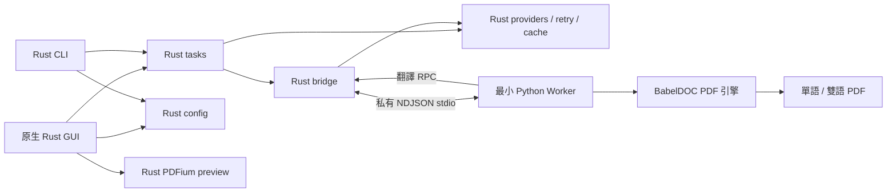

# Rust + BabelDOC 架構

Rust 負責全部應用程式功能：原生 GUI、CLI、設定、翻譯服務、HTTP、重試與限流、SQLite 翻譯快取、批次排程、取消、程序樹、PDF 預覽與檔案另存。Python 只保留 BabelDOC 0.6.3 引擎及 `python-worker/worker.py` 邊界；沒有 Gradio、Python App 或 Python 翻譯 client。

| Workspace crate | 職責 |
| --- | --- |
| `app` | eframe 原生桌面介面、設定編輯、進度、預覽與原子另存 |
| `cli` | clap 參數與共用載入流程；執行翻譯、資產維護或開啟 GUI |
| `config` | 舊 TOML 相容、235 項設定描述、24 個服務選項、合併優先序與原子儲存 |
| `core` | 16 種 provider、transport、retry、limiter、metrics、SQLite cache、程序控制 |
| `tasks` | 共用主／術語 translator factory、批次佇列、生命週期與 shutdown |
| `babeldoc-bridge` | 私有雙向 stdio、握手、回呼路由、取消、Worker 回收與資產初始化 |
| `pdf-preview` | 專用執行緒持有 PDFium；有界請求與最新結果去重 |



## 翻譯與取消

先驗證文件、glossary 與設定，再由共用 factory 為每份 PDF 建立服務。保留原版 main → 推薦參數 → term 的初始化順序，普通 Hello 健康檢查略過 cache；raw term QPS 決定是否共享 instance。主／術語服務與每 PDF 生命週期不藏在 Worker。

Bridge 啟動獨立 Python，將 stdin/stdout 留給版本化 NDJSON；Python／CRT／Win32 診斷輸出隔離至 stderr。session/task/request ID、有界 frame 與在途數、輸出路徑檢查可防止錯配或無界記憶體。API Key 不傳入 Worker。詳見 [IPC](IPC_PROTOCOL.md)。

BabelDOC 負責 PDF 解析、版面模型、段落／公式、引擎 prompt、排版、字型及 PDF 輸出。Worker 只轉接同步翻譯 callback、進度、取消與 BabelDOC 資源 API；不自行實作 API、retry、cache manager 或任務政策。

取消為獨立控制訊號，不當作可重試 provider 錯誤。Rust 等待 cooperative 清理；逾時終止並回收 Windows Job Object 內的 Worker／後代。GUI 關閉會先停止新動作，再等待 tasks、cache writer 與 PDFium 清理，最後關閉視窗。

## 設定與資源

預設使用 EXE 所在資料夾，與工作目錄無關：

```text
config/config.v3.toml          使用者設定
cache/translations.v2.db       Rust 翻譯快取
cache/babeldoc-home/           BabelDOC 的可變 HOME/cache
resources/worker-home/         包內唯讀模型、字型、CMap、tokenizer 種子
resources/engine-assets.json   精確種子清單、大小與 SHA256
runtime/python/                隔離 CPython 與必要引擎依賴
babeldoc/worker.py             最小 Worker
native/pdfium/                預覽 DLL 與必要資訊
```

首次翻譯時 Rust 只將 manifest 列出的 182 項資產原子複製到可寫 HOME，不複製 DB 或使用者翻譯 cache。已存在而雜湊不同的檔案會保留並回報錯誤；可指定新的 `--worker-home`，不默默覆寫使用者模型。初始化中取消會等待 writer 退出，沒有背景寫入工作遺留。

程式資料夾不可寫時，以呼叫端明確提供的 LOCALAPPDATA／HOME 解析使用者資料目錄，使用 `PDFMathTranslate/<來源資料夾 SHA256 前16碼>/` 避免不同安裝互相覆寫。原 portable 設定只複製一次且不取代已有備援設定，GUI／CLI 會顯示實際位置。明確指定 `PDF2ZH_APP_DIR` 失敗時會報錯，不擅自換位置。

設定優先序與原格式相容：CLI →環境變數→明確設定檔→portable 設定→預設。讀取不寫預設；保存清除本次 input_files，並以原子替換保護既有 bytes。敏感 Debug／錯誤遮罩、跨來源 redirect 移除憑證與回應大小界線仍保留。詳見 [服務相容性](PROVIDERS.md) 與 [cache](CACHE_COMPATIBILITY.md)。
