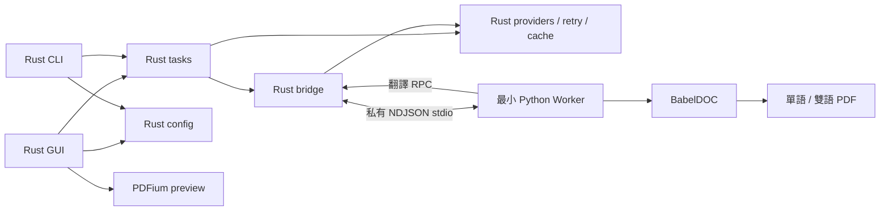

# BabelOxide 架構

Rust 負責應用程式與翻譯服務。Python Worker 橋接 **BabelDOC 0.6.4**。開發與封裝腳本獨立於使用者執行流程。

| Crate | 職責 |
| --- | --- |
| `babeloxide-app` | egui／eframe 視窗、設定草稿、檔案加入、佇列、預覽與另存 |
| `babeloxide-cli` | clap、共用設定載入、翻譯與資產維護入口 |
| `babeloxide-config` | 235 項 schema、24 個服務選項、TOML 相容、合併與原子保存 |
| `babeloxide-core` | 16 個 provider、HTTP、重試／限流、usage、SQLite cache、受控程序 |
| `babeloxide-tasks` | 主／術語服務 factory、串列批次、取消與 shutdown |
| `babeloxide-bridge` | 位於 `crates/babeldoc-bridge/`；Worker／私有 stdio、資產初始化與清理 |
| `babeloxide-pdf-preview` | 專用執行緒持有包內 PDFium、有界渲染佇列與舊結果去重 |



## 任務與設定

TaskManager 保持一批次執行，多份 PDF 依序處理。主／術語服務由共用 factory 初始化，保留健康檢查、推薦參數及服務共享規則；健康檢查可能呼叫 API。批次保存提交時的設定快照；手動重試只提交未完成文件，不重播已完成文件。GUI 同名輸入及已有成果使用獨立輸出子目錄，另存／ZIP 使用原子發布。

GUI 將常用設定放在工作區，進階欄位集中在設定頁。視窗小於 900 pt 時切換成工作區、設定與預覽頁籤，狀態同時提供文字提示。輸出位置留白時，GUI 使用可寫應用程式目錄下的 `outputs`，CLI 使用目前目錄。

設定優先序：CLI → 環境變數 → 明確設定檔 → portable 設定 → 預設。新 `BABELOXIDE_*` 優先於同名舊 `PDF2ZH_*`。保存保留未知欄位、清空本次 input_files；無效草稿不部分套用。自訂組合只保存白名單值，以 `babeloxide.presets_json` 字串放在既有 TOML，不含 Key、網址、檔案路徑或執行限制。

相對於 EXE 的預設布局（Mac 位於 `.app/Contents/MacOS/`）：

```text
config/config.v3.toml          使用者設定
cache/translations.v2.db       Rust 翻譯快取
cache/babeldoc-home/           BabelDOC 可變 HOME
resources/worker-home/         包內唯讀模型、字型、CMap、tokenizer 種子
resources/engine-assets.json   精確種子清單、大小與 SHA256
runtime/python/                獨立 CPython 與引擎閉包
babeldoc/worker.py             唯一正式 Worker
native/pdfium/                固定平台 PDFium 與版本檔
```

程式目錄不可寫時，Windows 使用 LOCALAPPDATA（或 HOME 的 AppData/Local），Mac 使用 HOME/Library/Application Support；新資料夾為 `BabelOxide/<安裝路徑 SHA256 前16碼>/`。同一安裝已有 `PDFMathTranslate/<fingerprint>/` config／cache 且新路徑不存在時，原地沿用，保留 SQLite WAL 與模型修改。明確指定 `BABELOXIDE_APP_DIR`（或舊別名）失敗即報錯，不擅自換路徑。

舊 home `.config/pdf2zh/config.v3.toml` 只在新設定不存在時讀取、驗證並以不覆寫方式發布；原檔不變。壞檔不發布成新設定。讀取本身不重寫預設或重置憑證。首次引擎初始化只原子複製 manifest 的 182 項種子；既有內容不同時保留並報錯，不覆寫使用者模型。

## IPC 與清理

每份 PDF 使用獨立 Worker。雙向 UTF-8 JSONL 的每個 frame（含 LF）上限 1 MiB；`v:1`、session、task_id 與 `w-N` request ID 區分身分及逆序回覆。Host 先準備服務，再協商在途容量（最少 128，最多 1,000,000）；ID 長度及曾用 ID 數量另有界限。

Worker 傳 `ready`（精確 BabelDOC 版號）、`translate`、白名單進度、`finished`／`error`；Host 回 `start`、`translated`、`cancel`、`shutdown`。API Key、provider endpoint／config 不傳入 Worker。stdout 專供協定；Python／CRT／Win32 診斷改送 stderr，Rust 持續排空。

Python reader／engine thread 分離，以 pending Future 配對翻譯；Rust reader 路由獨立 async 請求，不等待 HTTP／QPS／重試。寫入 channel 有界；慢 UI 進度可丟棄，terminal 由任務回傳，不依賴 UI queue。錯誤 framing、錯 session、未知／重複 ID、RPC 失敗或缺少要求的輸出都使任務失敗，不能被 BabelDOC fallback 掩蓋。

取消為獨立控制事件，停止新 admission／重試並等待 cooperative cache／程序清理。cancel_ack 不表示清理完成。成功須合法 finished、無 pending、mono／dual 路徑位於核准 output 內、要求的檔案存在且 Worker 正常退出；exit 0 或 EOF 單獨不足。

預設啟動 180 秒，PDF 閒置與 Worker RPC 等待各有 1800 秒期限，關閉期限為 10 秒。資產維護使用 start 後的固定期限。Windows 在子程序恢復前將其指派至 Job Object。macOS 為子程序建立獨立 process group，清理時終止並檢查群組成員，再回收直接子程序。

## 重試、限流與快取

每次 logical translation：計數／取消檢查 → 可用時讀 cache → provider preflight → concurrency permit → 一次 QPS admission → provider 及各層重試 → 寫入成功文字。Cache hit 不消耗 QPS／HTTP／usage；SDK 與應用層不能合併成一個通用重試。取消不能被 provider retry predicate 捕捉。

`tests/baseline/` 與 `crates/core/tests/fixtures/legacy_retry_contract_v1.json` 保留獨立 Python oracle：22 個 policy、R23–R34、T01–T05 及 SDK 常數。原始 Python／歷史稽核可從 `codex/baseline-final-integration-20261031` 回復到另一路 checkout；凍結檔的歷史來源路徑不改寫。此次品牌／UI 不改 retry、backoff、QPS、concurrency 或 cache identity 演算法。

引擎批次呼叫遇到 HTTP 5xx 或傳輸錯誤時，Rust 耗盡既有重試後將錯誤交回 BabelDOC，讓引擎執行逐段回復。逐段、術語、驗證與預檢錯誤會使任務失敗。Worker 確認必要段落已套用後才回報完成。

SQLite 新表 `rust_translation_cache_v2` 使用版本化 namespace digest，區分 provider、endpoint、model、語言、方法、角色與影響輸出的參數；排除明確 Key 與 QPS／concurrency／timeout 等操作值。舊 `pdf2zh-rust-cache-v2` identity 字串刻意保留。輸入及譯文按既有行為明文保存，沒有 TTL、淘汰或 singleflight。

Cache read／write 的普通錯誤計入 metrics，仍可返回有效 provider 文字；取消不吞掉。SQLite busy／locked 最多使用既有一秒預算；取消等待 blocking writer 完成／回滾，已完成的 commit 不可撤回。舊 `_translationcache` 不刪改；精確讀取／提升須 caller 明確綁定已驗證的 namespace、方法與角色，不自動猜測歸屬。

## 執行期與驗證

BabelDOC 處理 PDF 解析、版面、公式、引擎 prompt、字型與生成；Worker 不重做演算法。Windows 85／Mac 84 個固定 wheel（差異 colorama）與 182 項資產由 builder 查核；OpenAI、Peewee、Tenacity 等屬引擎宣告閉包，不能因名稱像舊 App 就移除。PDFium 使用固定包內絕對路徑，Windows 驗 PE，Mac 驗 arm64 Mach-O；不從 PATH 猜測版本。

來源與建置 pins 見 [建置](BUILD.md)。SDK 差異、平台與安全邊界見 [已知限制](LIMITATIONS.md)。
