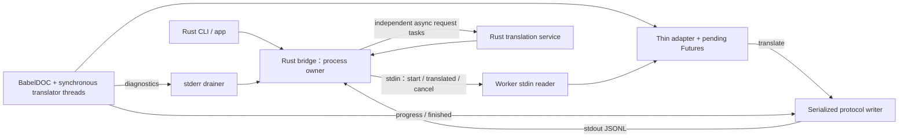

# Rust / BabelDOC IPC v1

更新：2026-10-31；Python對照基準：`d18165e`。本文描述目前 wire contract 與邊界。測試範圍、個人執行包驗收與限制以 [FINAL_STATUS](FINAL_STATUS.md) 為準，不代表所有 provider SDK 行為或乾淨 Windows 環境完全等價。

最初PoC審查曾因graph連線不可用而採直接source fallback；本輪工具已恢復。2026-10-28T12:16:29Z的coverage對bridge、process、CLI、worker與相關測試皆為metadata_match／no_recorded_issue；這是best-effort freshness訊號，關鍵協定與程序保證仍以source及實測核對。既有Python的34案例對照見RETRY_COMPATIBILITY。

## 邊界

Rust `core`持有TranslatorConfig、TranslationRequest、PdfJob及翻譯service；`babeldoc-bridge`主控程序、IPC與取消；CLI及後續app共用核心。每PDF啟動一個worker。這不代表一次只有一個文字請求：BabelDOC會從多個同步執行緒呼叫translator，stdio必須支援多個outstanding IDs及逆序responses。

Python worker只直接載入BabelDOC、建引擎config、呼叫引擎、轉送翻譯/進度/結果、取消引擎及清理。它不繼承原應用BaseTranslator，不import原PythonGUI/CLI/config/controller，不擁有provider HTTP、retry、QPS或應用快取。transport pending map、局部failed/cancelled旗標是必要薄層，不是另一套應用生命週期管理。



## 公開 wire contract

- UTF-8 JSONL，LF終止；**每個frame包含LF最多1 MiB**。文字換行由JSON跳脫。不得用JSON傳整份PDF、模型或字型二進位；PDF走核准本機絕對路徑。
- 每個message有`v:1`與`type`。worker以`secrets.token_hex(16)`產生32字元hex `session`，由ready交給host；此後雙方驗session。它是process identity，不是額外網路服務的authentication token。
- ready時尚未開始任務，不帶task_id。start及之後的task frames使用`task_id:"job-1"`；每process只有一PDF，跨PDF靠不同session區分。
- worker translation ID是`w-N`，同一session不重用。host以相同`id`回覆，不能依順序配對。host另限制ID長度64與每任務最多1,000,000個曾用ID。
- Host先完成服務preflight，再以`clamp(main_pool + term_pool, 128, 1_000_000)`協商outstanding容量；start新增可選`max_outstanding`，舊host省略時worker仍預設128。超容量明確失敗，並非另一套Python排程器。已用200個同時在途的真loopback請求驗證不再硬卡128。

| 方向 | type | 內容與意義 |
|---|---|---|
| worker→host | `ready` | session、babeldoc_version（目前鎖定0.6.3）。目前檢查package metadata；不保證大型模型載入與PDF初始化已完成 |
| host→worker | `start` | job:PdfJob；translator:{name,llm}；可選term_translator:{name,llm}及max_outstanding。API key、endpoint、provider config不傳worker |
| worker→host | `translate` | id、text、method:translate/llm_translate、ignore_cache、rate_limit_params、translator:main/term |
| host→worker | `translated` | 相同id，成功text或error:{code,message}。現PoC對translation service failure會終結PDF |
| worker→host | `progress` | event:JSON，引擎進度欄位白名單；不傳任意例外物件或PDF全文 |
| worker→host | `finished` | result含輸出路徑；必須無active translation、沒有RPC failed旗標，且符合要求的mono/dual產物 |
| worker→host | `error` | code、message；protocol_failed / engine_failed / translation_failed / cancelled等安全分類 |
| host→worker | `cancel` | 無request id，session/task辨識；取消必須冪等 |
| worker→host | `cancel_ack` | 確認取消已被接收，不代表所有資源已釋放 |
| host→worker | `shutdown` | 終止本process生命週期；未完成任務須先取消 |
| worker→host | `shutdown_ack` | 確認收到關閉；host仍須wait與清理 |

```json
{"v":1,"type":"translate","session":"0123456789abcdef0123456789abcdef","task_id":"job-1","id":"w-17","text":"A formula: {v1}","method":"translate","ignore_cache":false,"rate_limit_params":{},"translator":"main"}
{"v":1,"type":"translated","session":"0123456789abcdef0123456789abcdef","task_id":"job-1","id":"w-17","text":"一個公式：{v1}"}
```

一般與術語可使用同一Rust service，或分別傳入兩個service；worker據metadata建立main／term adapter並送正確角色。共享Arc只統計一次usage，結果的`translation_metrics`標示shared_service，獨立term才有第二組counter。這些是service生命週期統計；跨任務重用service時不是自動歸零的每任務差值。`do_llm_translate(None)`是本地能力probe，不產生API請求；translate與llm_translate分開，避免把引擎已建prompt再包一次。

`glossary_files`與`max_pages_per_part`只轉換成BabelDOC既有Glossary／split strategy；worker不自行實作術語管理或PDF分割。`term_qps`由Rust消費，不進引擎config；pool設定可進BabelDOC。服務建議的QPS／pool在引擎啟動前套用；SiliconFlowFree設定探測失敗時的10／100建議不額外改變原有Rust limiter，保留Python的細節差異。

## Framing 與並行

### 引擎資產操作

`start.operation` 可為 `pdf`（省略時亦是 PDF）、`warmup`、`generate_offline_assets`、`restore_offline_assets`。ready 新增 operations capability；維護操作啟動前必須確認支援。三種維護操作不含 job／translator／credential，只傳必要的絕對 path；任何 translate RPC 都是 protocol error。它們與 PDF 共用同一私有程序、framing、exit 觀察、取消及 kill／wait，沒有第二份程序控制器。

Worker 直接呼叫 BabelDOC assets API，返回 kind 與官方 manifest 的 64 hex tag；generate 額外回 archive_name。Rust 只在 finished、exit 0、程序樹清理均成功後，驗 staging canonical 路徑與精確 basename，再分塊複製至同目的目錄的暫存檔、flush／sync、原子 persist。commit 前取消或錯誤保留舊檔；最後檢查到 persist 的競速可能由完整新檔提交獲勝。

資產操作的 `WorkerOptions.idle_timeout` 是 start 後的絕對期限，progress 不續命；PDF 仍為 activity idle deadline。資源 API 沒有 byte progress callback，不虛構下載百分比。restore 沿用 BabelDOC 逐檔 manifest＋SHA3 流程，並非整個 cache 的交易；中斷後可重跑修復。固定資產清單見 [asset lock](../resources/engine-assets.lock.json)，可變 HOME 與初始化規則見 [架構](ARCHITECTURE.md)。

Host逐段讀取並限制buffer；partial-frame bytes保存在外層Vec，避免Tokio select取消read future時丟資料。EOF仍有半行、無效UTF-8/JSON、非object、不支援v、錯session/task及未知type都失敗；不能以「忽略不像JSON的stdout」掩蓋污染。Worker用有界binary readline；sender須檢查序列化後byte長度。

Python主執行緒只讀stdin與路由responses/cancel，BabelDOC在獨立engine thread運作；每個同步adapter呼叫登記Future、送translate、等待自己的結果。pending鎖僅保護短操作，不跨等待；單一write鎖確保frame不交錯，raw write須處理partial write。取消/EOF解除全部pending。register-before-send防止立即回應找不到waiter；resolve只一次，未知/重複id失敗，取消後在途responses可忽略。

Rust reader只路由，不await HTTP/QPS/retry。每個translate是獨立JoinSet task；單一stdin writer透過有界channel寫回；stderr另有持續drainer；process owner監控取消、退出及deadlines。兩個直接deadlock模式必須排除：Python等待result的同一thread還要讀stdin；Rust reader收到translate就等待整個HTTP再讀下一frame。

progress、response與control共用pipe但語意不同。Host write channel容量為協商outstanding+4，每frame有界；worker同步writer鎖提供pipe背壓。UI介面已改為bounded Sender，CLI容量64，reader以try_send丟棄壅塞進度；terminal經函式回傳，不依賴進度queue。未讀取容量2的queue也能完成2000個progress事件後的terminal。尚未另加總byte budget、進度合併與完整控制優先佇列，不能據此宣稱長時間記憶體與大型PDF壓力驗收完成。

即使cancel有優先queue，已開始寫入的frame也不能被插入控制資料；對方完全不讀仍需要獨立cleanup deadline。超大文字應明確失敗，不能靜默截斷公式或任意讀外部暫存檔補救。

## stdout / stderr

worker在BabelDOC import前保留專用protocol input/output fd，將標準stdin／CRT fd0及Win32 STD_INPUT_HANDLE導到NUL，Python stdout／CRT fd1及Win32 STD_OUTPUT_HANDLE導到stderr。協定reader只讀private stream，避免第三方讀走控制資料或native import與標準stdin鎖競爭。兩個duplicate均明確set_inheritable(False)，任一步失敗清理私有fd。不可跨執行緒強關正阻塞讀取的BufferedReader。只用redirect_stdout不足以攔截native輸出。

驗收分別產生Python print、os.write(1,...)及Windows WriteFile(GetStdHandle(STD_OUTPUT_HANDLE),...)，stdout必須仍只有JSONL；標準stdin三種讀法應為EOF，private stream仍可讀合法frame。Host持續以byte stream排stderr；預設排入sink，僅debug模式在指定output內保留最多16MiB診斷，剩餘繼續排空。stderr字樣不能決定任務成功或作為控制指令。

## 結果、錯誤與取消

Rust是任務terminal權威。failed/cancelled不能被之後finish翻回成功。worker RPC失敗設獨立failed旗標，finish前再次檢查，防止BabelDOC內部fallback吞掉一般Exception而輸出「成功」。BabelDOC正常收尾也可能觸發自己的cancel_translation；這與host用戶取消旗標分開，不能誤報成功任務被取消。

成功至少需要合法finished、無pending、要求的mono/dual路徑存在且在核准output根目錄、worker正常退出。exit0或EOF本身不代表成功；缺任一要求產物要失敗。現路徑檢查不等於PDF格式/頁數/文字/排版回歸，這些另由真實PoC與PDF測試驗證。

取消順序：host取消token → 停止新API/重試/admission → 發cancel並保持stdout drain → worker標記局部取消、解除pending、呼叫config.cancel_translation → ack → 等provider清理 → shutdown/wait。HTTP task可在grace後abort；CLITranslator／ClaudeCode及其名稱別名須cooperative join到底，不能在kill-and-reap中途丟棄future。Worker超過grace則終止程序樹。cancel_ack不是cleanup完成；本地取消不保證遠端provider撤回已受理請求，因此不自動重播整份PDF。

第一次主錯誤保留，後續cleanup失敗只增加安全context。Rust provider已有typed kind、retry layer、attempt與最末cause；Python wire仍只送通用translation_failed，避免文件與憑證進入引擎日誌。這是語意分類對照，不是重建Python例外類別本身；各服務證據與剩餘差異見PROVIDER_TEST_MATRIX及PROVIDER_REVIEW。

## Timeout 與 process tree

| 類別 | PoC / 對照語意 |
|---|---|
| startup | WorkerOptions預設180秒，spawn到ready；ready後引擎import/model初始化另受活動/cleanup限制 |
| task idle | 預設1800秒。舊Python是每次queue.get等待下一進度事件；不是PDF全程30分鐘。現host每有效frame都刷新activity，完整相容版應區分工作進度與純liveness |
| worker RPC wait | Future.result上限1800秒；額外transport護欄，需在完整provider移植時與100-attempt策略協調 |
| provider | Rust core依各provider保留application／SDK inner retry與timeout區別；write／pool逐階段等價仍有界限，詳PROVIDER_TEST_MATRIX |
| shutdown | 預設10秒；超時kill，處理writer/drainer並wait。測試可縮短驗證 |
| exited drain | 已觀察exit0後，只給有限窗口讀取已寫但尚未處理的terminal，避免孫程序持pipe造成無限等EOF |

使用本地monotonic計時；不要跨process比較未定義epoch。heartbeat若日後加入，不得延長真正engine idle。完整版本新增task-total或per-RPC deadline需明示，不能稱為既有Python行為。

Host在startup與running都必須觀察child退出及writer失敗，不能只等stdout EOF。child退出但孫程序持stdout時，Job handle仍活著，單純等EOF可卡到1800秒。exit0仍可能有合法finished已在pipe，因此先短有界drain；非零立即失敗。

Windows使用CREATE_SUSPENDED→Job Object設定KILL_ON_JOB_CLOSE→AssignProcessToJobObject→Resume，避免加入Job前先spawn孫程序；Job handle不繼承。assignment/resume失敗清理child。顯式cleanup另呼叫TerminateJobObject並輪詢Job ActiveProcesses=0，然後wait direct child；只關閉handle不代表後代已完成退出。穿過bridge的CLI取消測試在回傳前取得固定HANDLE，回傳後立即驗root與descendant已非STILL_ACTIVE；沒有將此結論外推到極端OS無法完成終止的情況。這是程序樹生命週期機制，不是惡意PDFsandbox。[Microsoft Job Objects](https://learn.microsoft.com/en-us/windows/win32/procthread/job-objects)與[AssignProcessToJobObject](https://learn.microsoft.com/en-us/windows/win32/api/jobapi2/nf-jobapi2-assignprocesstojobobject)是此封裝的依據。

Tokio kill_on_drop是最後防線，不能替代顯式wait與程序樹測試。[Tokio process文件](https://docs.rs/tokio/latest/tokio/process/index.html)區分drop、kill與reap。當worker死而後代持pipe時，exit watcher須主動推進cleanup。非Windows目前未實作process group同等保證，不可把Windows結果外推。

## 路徑與資源

Host以絕對Python/worker路徑及`-I -u`啟動，不經shell；清空環境，只給必要系統、home、temp與encoding變數，API key/endpoint不進worker。output canonical root限制worker產物；temp由host建立與持有，清理不得刪使用者input或既有產物。引擎字型/模型共用cache與單任務temp分開。

尚需測Windows junction/reparse、輸出替換競爭、檔案鎖、異常drop及長期資源清理。匿名pipe限制外部接入，但與使用者同權限的worker不是安全隔離sandbox。

## 必要 behavior tests

以下為驗收清單，不能因文件列出就標記通過。假worker只測transport/process，真BabelDOC固定翻譯fixture才測PDF引擎。

已新增`crates/babeldoc-bridge/tests/lifecycle.rs`與純stdlib `tests/fixtures/fake_worker.py`，涵蓋startup crash、exit0無terminal、buffered finished後exit0、缺mono/dual、5種錯誤frame/identity、強制取消，以及Windows持stdout的孫程序crash/取消。Windows測試在觸發退出前保留OS process handle，避免僅憑PID列表推測清理成功。這些是測試實作；執行結果須由統一cargo test填入報告。

| ID | 情境 | 必要斷言 |
|---|---|---|
| I01 | startup crash / 版本不合 / 初始化失敗 | 有界失敗、不誤成功、child已wait |
| I02 | 多同步translation、逆序response、progress交錯 | id配對正確、不head-of-line blocking、pending清空 |
| I03 | duplicate/unknown/late id、錯session/task | 不重複完成/釋放；按契約失敗或取消後忽略 |
| I04 | UTF-8分段、partial read/write、select取消 | frame無遺失或交錯 |
| I05 | malformed/oversize/noLF/partialEOF | buffer有界、所有pending解除 |
| I06 | stderr與progress洪水、慢UI、pipe不讀 | 不deadlock、界限與取消有效；未實作的界限明列 |
| I07 | Python/CRT/Win32 stdout來源 | diagnostics全部隔離、protocol保持純淨 |
| I08 | cancel於HTTP/QPS/Future/writer/engine init | 沒新attempt、有界結束、無pending/permit洩漏 |
| I09 | cancel與finished競爭、重複cancel | 單一terminal、ack不假裝cleanup完成 |
| I10 | exit0無finished、非零、BrokenPipe、finished後exit | 不誤成功；合法buffered finished不被exit競爭遺失 |
| I11 | worker crash + 孫程序持stdout | 快速察覺exit、整棵樹退出，不等idle1800 |
| I12 | 忽略cancel/shutdown的worker與孫程序 | grace後強制清理、process handles確認退出 |
| I13 | timeout可控時間、late response、heartbeat | idle/transport/provider不混淆 |
| I14 | 真PDF mono/dual固定翻譯 | Rust→worker→Rust→BabelDOC輸出走通；頁數/文字/渲染另比對 |
| I15 | 重複/並行多PDF、長期運行 | session/temp隔離，handles/threads/memory不持續增加 |
| I16 | RPC fail被BabelDOC內部fallback捕捉 | failed旗標阻止誤成功，worker沒有第二套retry |

依「Sol實作 → Astra審查 → tests → fix → commit」逐項留證據。一次PoC成功不能推出完整provider等價、無程序殘留、乾淨Windows或正式發行完成。
