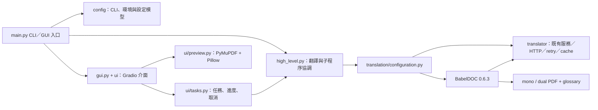
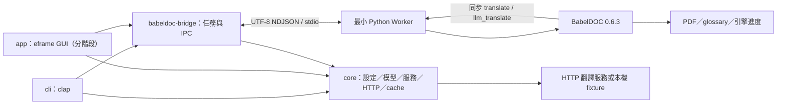

# Rust／BabelDOC 混合架構與引擎契約

更新：2026-10-29。目標分支：`feature/rust-babeldoc-hybrid`。Python 回歸基準為 `d18165e`，保留標籤 `rust-python-baseline-20261026`、`pre-rust-main-20261026`。本文描述已核對的Python基準與分階段移植設計；**架構圖不代表GUI或Windows發行流程已完成**。PoC已驗證OpenAI固定回應端點與真實PDF引擎，第5階段進一步實作16種Rust服務並測分層retry；完整產品設定、CLI、GUI與發行仍待移植。

第5階段的`core`依獨立職責拆為providers、transport、retry、limiter、metrics、error及共用process模組，未為每個模組增加crate。`TranslationService`負責一次logical call的preflight、admission與provider dispatch，provider保留各自SDK內層重試。外部CLI使用共用程序樹封裝；薄Python adapter不含上述應用邏輯。行為證據與差異見 [測試矩陣](PROVIDER_TEST_MATRIX.md)。

## 責任邊界

Rust 持有應用程式設定、CLI／GUI 狀態、服務選擇、HTTP、重試、限流、翻譯快取、任務與輸出管理。BabelDOC 0.6.3 繼續持有 PDF 解析、版面辨識、段落與公式佔位、內容 prompt 組裝、排版、字型與 mono／dual 產出。保留引擎版本、演算法與既有排版行為，不改寫或 monkey-patch 安裝套件。

Python Worker 只持有程序入口、BabelDOC 初始化、有限引擎選項的型別轉換、同步翻譯 callback 的 IPC 轉接、進度／結果序列化及合作取消。它不得 `import pdf2zh_next`，不得載入舊 `ConfigManager`、舊 translator factory、HTTP SDK client、舊 cache 或舊 retry／limiter 模組。Worker 因 BabelDOC 的 import 閉包而載入 `openai`、`peewee`、`tenacity` 套件，與 Worker 自己執行這些應用政策是不同事情；不能為縮小包體任意刪除上游必要套件。

### 有限範圍的基準模組圖

另有本次 AST 掃描全部 55 個 Python 來源模組的 [靜態匯入圖](PYTHON_MODULE_GRAPH.mmd) 與 [完整節點／125 條內部邊、外部根模組及動態 import 位置](PYTHON_MODULE_GRAPH.json)。這是來源掃描，不是執行期所有動態關係的證明。



這是整合邊界圖，不是所有 imports 或完整呼叫圖。已確認：`pyproject.toml` 的三個命令入口指向 `pdf2zh_next.main:cli`；`main.py:16–17,95` 使用設定、翻譯入口與 GUI；`gui.py:193–208` 將 `do_translate_async_stream` 以 `stream_factory` 注入 `ui/tasks.py:32–114`；`high_level.py:463–514` 選擇一般子程序或 debug 原程序路徑；`translation/configuration.py:31–140` 建立 translator 與 BabelDOC 設定；`ui/preview.py:12–37` 經 PyMuPDF pixmap 建立 Pillow 影像。圖譜未完整捕捉 `partial`、注入函式及 async generator 的間接呼叫，不能以零 caller 推論無人使用。

### 目標 crate 與程序圖



| crate／元件 | 責任 | 初期驗收範圍 |
|---|---|---|
| `core` | 分離 config、models、translators、network、cache；來源優先序、命名映射與 validation；provider 身分與錯誤型別；唯一應用級 retry／limiter／cache | OpenAI 相容固定回應端點；不把所有原服務標成已移植 |
| `babeldoc-bridge` | worker 啟停、版本握手、雙向 IPC、請求關聯、任務狀態、取消、程序回收、輸出路徑驗證 | 先單 worker／單文件；多文件排程另外驗收 |
| `cli` | clap 參數、載入 core 設定、進度與 exit code | 呼叫同一 core／bridge，不能另寫一套 HTTP 政策 |
| `app` | eframe 介面、進度、取消、設定與結果呈現 | 規劃；不得因選定框架即聲稱舊 GUI 的所有選項與預覽等價 |
| Python Worker | 引擎呼叫與資料轉接 | 不 import `pdf2zh_next`；key 不進 worker；只接受有限 engine options |

CLI 與 GUI 共用 Rust 設定與任務模型。UI 不直接組裝 Python kwargs，也不直接持有 provider client。原本 GUI 產生的隱含值、翻譯／術語設定共用規則及負向選項（例如 `no_auto_extract_glossary`）必須在 core 明確映射；Worker 只接受正規化後的引擎值。Preview 初期可以開啟已產生的 PDF；要重建內嵌翻頁／縮放時，先另定渲染介面，不把舊 Gradio／Pillow UI 搬回 Worker。

## BabelDOC 0.6.3 已核對介面

下列 `B/` 表示本機 `.venv/Lib/site-packages/babeldoc/`，不是新的儲存庫模組。以安裝來源核對，13 個核心來源檔的內容均與該 distribution 的 `RECORD` 雜湊相符。

```python
from babeldoc.format.pdf.high_level import init, async_translate, translate
from babeldoc.format.pdf.translation_config import (
    TranslationConfig,
    WatermarkOutputMode,
)
```

`init()` 只建立 cache 資料夾（`B/format/pdf/high_level.py:1164–1177`），不等於全部模型／字型已就緒。`TranslationConfig(..., doc_layout_model=None)` 會呼叫 `DocLayoutModel.load_available()`，並建立輸出／工作目錄（`B/format/pdf/translation_config.py:287–312`）；這個初始化步驟可能讀取或下載資產，必須納入啟動與取消逾時。

| 介面 | 真實行為與橋接要求 | 來源 |
|---|---|---|
| `translate(translation_config) -> TranslateResult` | 同步建立 ProgressMonitor 並執行；可用於不需事件的呼叫，不是目前互動任務首選 | `B/format/pdf/high_level.py:259–261` |
| `async_translate(translation_config)` | async generator；內部用 executor 執行同步 `do_translate`，持續 yield 事件 | 同檔 `299–376` |
| `TranslationConfig(translator, input_file, lang_in, lang_out, doc_layout_model, ...)` | `translator` 型別標註不阻止純轉接物件；不需繼承 BabelDOC BaseTranslator | `B/format/pdf/translation_config.py:160–222` |
| `config.cancel_translation()` | 有 monitor 時委派 `monitor.cancel()`；monitor 尚未綁定時不會記住取消 | 同檔 `477–483` |
| `config.raise_if_cancelled()` | 委派 monitor；被引擎分階段／分段落呼叫 | 同檔 `477–479`；`B/progress_monitor.py:250–259` |
| `TranslationConfig.create_max_pages_per_part_split_strategy(n)` | 建立引擎 split strategy；不得把 Rust 整數直接當 strategy 物件 | `B/format/pdf/translation_config.py:154–156` |
| `WatermarkOutputMode` | `Watermarked`、`NoWatermark`、`Both` enum；從有限字串顯式轉換 | 同檔 `21–25` |

PoC 必須顯式傳 `input_file`、`output_dir`、語言、translator、`doc_layout_model=None`、頁面範圍、mono／dual、watermark、`pool_max_workers`、`term_pool_max_workers`、`report_interval` 與術語選項。`qps` 的設定值會作為預設 thread-pool 數，但它不等於 Rust 發送速率；不讓使用者高 QPS 無限制地建立 Python 執行緒。以 `use_rich_pbar=False` 配合獨立 stderr，stdout 僅留給協定。

舊應用的正規化預設不可直接替換成引擎預設。AST 比對 `config/model.py`、`translation/configuration.py` 與安裝的 `TranslationConfig.__init__`，可純值比較的設定中，`qps` 為舊應用 4／引擎 1；**`remove_non_formula_lines` 為舊應用 `True`／引擎 `False`**。後者來自 `not settings.pdf.no_remove_non_formula_lines`，會影響線條／公式處理。Rust config 必須顯式保留舊應用預設，再讓使用者覆蓋；Worker 不自行補一套舊設定政策。

`font` 在 0.6.3 被忽略；`table_model` 無條件改為 `None`，舊 table-text 選項已退休（`B/format/pdf/translation_config.py:228–229,326–331`）。Rust 不能將接受舊設定解釋成這些功能重新可用。

### 同步 translator 契約

BabelDOC 由自己的 thread pool 同步呼叫 translator。Worker callback 發出請求後，應等待對應 Rust 回應；不要在 callback 另啟 `asyncio.run()`，也不要在等待期間阻止 stdin 控制訊息的讀取。

```python
translate(text: str, ignore_cache=False, rate_limit_params=None) -> str
llm_translate(text: str, ignore_cache=False, rate_limit_params=None) -> str
do_llm_translate(text, rate_limit_params=None)
get_formular_placeholder(placeholder_id) -> tuple[str, str]
get_rich_text_left_placeholder(placeholder_id) -> tuple[str, str]
get_rich_text_right_placeholder(placeholder_id) -> tuple[str, str]
```

- `do_llm_translate(None)` 是能力探測，支援 LLM 時本地 `return None`，**不得產生 IPC／HTTP 請求**；不支援時 `raise NotImplementedError`。高階引擎與兩種 IL translator 都會探測（`B/format/pdf/high_level.py:246–256,989–1001`；`B/format/pdf/document_il/midend/il_translator.py:356–362`）。`do_translate` 可保留同義轉接供介面相容，但目前主要管線呼叫的是 `translate`／`llm_translate`。
- `llm_translate` 收到的是 BabelDOC 已組好的內容 prompt；不得再加上普通逐句翻譯包裝。`translate` 則由 Rust provider 產生適當的普通翻譯請求。Rust API key、endpoint 認證與 provider client 全留在 Rust。
- `rate_limit_params` 至少含 `paragraph_token_count`；LLM batch 與術語抽取還會含 `request_json_mode=True`。必須傳回 Rust，保留未知欄位的向前相容性；JSON mode 是否支援由服務能力判定（`B/format/pdf/document_il/midend/il_translator.py:1241–1262`；`il_translator_llm_only.py:709–715`；`automatic_term_extractor.py:327–333`）。
- 佔位方法回傳 `(實際文字, regex)`，ID 可能是整數或 `r"\d+"`。可直接遵循 BabelDOC 自己 `tools/executor/translator.py:154–164` 的協定：`{vN}`、`<style id='N'>`、`</style>` 及對應空白容忍 regex。不能照搬 `B/translator/translator.py:193–200` 的舊 BaseTranslator 字串回傳，因 ILTranslator 會索引 `[1]` 並編譯 regex。
- 建議明確提供 `name`、`model`、`lang_in`、`lang_out`、`ignore_cache` 作穩定身分與診斷；已讀主要管線沒有要求由 worker 保存 API key 或實體 cache。token 計量屬可選介面：引擎以 `getattr` 讀取 `token_count`、`prompt_token_count`、`completion_token_count`、`cache_hit_prompt_token_count`，若提供就必須是可讀 `.value` 的計數物件（`automatic_term_extractor.py:160–177`）。Rust 是完整使用量的權威來源。
- 主翻譯與術語可用不同 proxy，各自標記 role，Rust 決定 provider／模型／配額。相同服務可共用 Rust client 與帳戶級速率預算，不能只因同一份 PDF 就混用兩個模型的 cache。

### 進度、結果與終態

`progress_start`、`progress_update`、`progress_end` 包含 stage、stage_progress、stage_current、stage_total、overall_progress；實作另外包含 `part_index`、`total_parts`（`B/progress_monitor.py:163–173,214–234`）。數值為百分比，不是 0–1；Rust 可於邊界正規化，保留原 stage 字串供診斷。

`finish` 包含 `TranslateResult`，必須以白名單轉為 JSON：`original_pdf_path`、`mono_pdf_path`、`dual_pdf_path`、`no_watermark_mono_pdf_path`、`no_watermark_dual_pdf_path`、`auto_extracted_glossary_path`、`total_seconds`、`peak_memory_usage`、`total_valid_character_count`、`total_valid_text_token_count`。路徑轉字串，未設定欄位用 `null`；不能對任意 `__dict__` 或 `Path` 直接序列化（`B/format/pdf/translation_config.py:509–537`；`B/format/pdf/high_level.py:685–709`）。

`error` 不保證是字串，可能是 exception 實例或 `CancelledError` 類別。Worker 必須轉成穩定 code、message、可選診斷欄位，stderr 不原樣輸出私密 prompt／憑證。

**必須以自己的 job 狀態鎖定唯一終態。** 引擎 `do_translate` 先呼叫 `pm.translate_done(result)`，finally 再呼叫 `pm.on_finish()`；0.6.3 的 `on_finish()` 會無條件設 cancel event，並嘗試通知 `error=CancelledError`（`B/format/pdf/high_level.py:719–733`；`B/progress_monitor.py:139–147`）。正常 async 路徑的 `AsyncCallback.finished_callback` 會忽略第二個終態通知（`B/asynchronize/__init__.py:28–34`），因此不應宣稱正常成功一定會 yield 第二個 error；但仍不能把引擎清理時已設的 cancel event 當成「使用者取消」。使用者取消、RPC 失敗與引擎清理旗標分開記錄。

## 雙向 stdio IPC 設計

以下是協定設計要求；實際欄位與驗收情況以 `babeldoc-bridge`／Worker 實作及測試為準。

| 方向 | 訊息 | 必要內容 |
|---|---|---|
| Worker → Rust | `ready` | 協定版本、Python／BabelDOC 版本、支援能力；版本不符立即拒絕 job |
| Rust → Worker | `start` | job_id、有限且已驗證的 engine options、主／術語 translator 能力與不含秘密的身分 |
| Worker → Rust | `translate_request` | job_id、request_id、role、method、text、ignore_cache、rate_limit_params |
| Rust → Worker | `translate_response` | 同 job_id／request_id；恰好一個 text 或結構化 error；可含 usage |
| Worker → Rust | `progress` | job_id、stage 與進度、分段資訊 |
| Rust → Worker | `cancel` | job_id；可重複，語義冪等 |
| Worker → Rust | `finished`／`failed`／`cancelled` | job_id、唯一終態、結果或錯誤；不能只用程序 exit 0 判成功 |
| Rust → Worker | `shutdown` 或 stdin EOF | 停止接新工作、取消未完成 RPC、回收引擎與程序 |

使用 UTF-8 NDJSON：每行一個完整 JSON envelope，文字內換行由 JSON escape。stdout 只有協定；logging／第三方 print 導到 stderr。保存原始協定 writer，採單一 writer 或 lock 保證跨執行緒不交錯。Rust 與 Worker 均設訊息大小／排隊／同時未完成請求上限；不能直接用不設限的 `read_line` 當完整資源保護。

Python 有獨立 stdin reader，依 request_id 解鎖等待中的 callback；async event loop 持續轉送進度。Rust stdout reader 不可一邊等待 HTTP 一邊停止讀下一行，否則 parallel callbacks 與進度會互相阻塞。Rust supervisor 即使 HTTP 正在執行，仍能接收 UI cancel、處理 EOF 與 drain stderr。每個 callback 產生新的 request_id；同一 callback 內的 HTTP retry 保持同一 request_id，便於區分引擎 fallback。

取消順序：先記錄自有取消狀態、取消 Rust HTTP／退避等待、喚醒所有 Python RPC waiters，再呼叫 `config.cancel_translation()`。若取消早於 `TranslationConfig`／monitor 就緒，在初始化後立即補送取消。只 `asyncio.Task.cancel()` 不足以停止已進入 executor 的同步工作；若引擎在 native code／初始化卡住，Rust 等待有限 grace period 後終止該 job 的 worker，等待程序確實退出並收集 stderr。這是隔離邊界，不代表已驗收所有 native 呼叫的取消時間。

初始化與清理也有獨立邊界：`TranslationConfig` 在啟動 `async_translate` 前就會建立臨時工作目錄。若 config 已建立但因取消／錯誤尚未啟動 stream，需明確呼叫 `cleanup_temp_files()`；此時引擎的 `do_translate.finally` 尚不會執行。正常 finish 後 `stream.aclose()` 可能略過 generator 尾部的 finish-event 等待，但目前 one-job Worker 以 `asyncio.run()` 執行，會在外層送成功前關閉 default executor；不要將這項程序行為泛化成 `aclose()` 本身能等待或中止所有引擎執行緒。

## 單一政策所有者與內容 fallback

| 層次 | BabelDOC 原有行為 | 混合架構處理 |
|---|---|---|
| HTTP 重試 | `OpenAITranslator.do_translate`／`do_llm_translate` 使用 Tenacity，RateLimitError 最多 100 次、1–15 秒指數等待，另建立 SDK client | 不建此 translator；Rust 有限 attempts／elapsed budget、Retry-After、取消感知；不得再套 worker HTTP retry |
| 應用限流 | BaseTranslator wrapper 每次 cache miss 都進全域 RateLimiter | 純轉接物件覆蓋整個 translate／llm_translate 契約，不呼叫 BaseTranslator wrapper；Rust 為唯一服務限流 |
| 翻譯快取 | BaseTranslator 讀寫 Peewee TranslationCache | Worker 不建立／使用此 cache；Rust 擁有 schema、key、失效與清除政策 |
| 引擎平行度 | TranslationConfig pool_max_workers／term_pool_max_workers 控制 thread pool | 保留、設有限上限；與 Rust HTTP concurrency 分別管理 |
| 內容 fallback | LLM batch JSON／段落檢查失敗後，ILTranslatorLLMOnly 送回較小段落翻譯 | 保留引擎行為；算新的 callback，不偽稱完全沒有第二次翻譯 |
| 資產下載 | BabelDOC 自行取得字型／模型／CMap，依上游 metadata 驗 hash | 保留引擎資產政策，與「翻譯 HTTP 政策只在 Rust」分開說明 |

來源：`B/translator/translator.py:28–76,120–165,259–297`；`B/format/pdf/document_il/midend/il_translator_llm_only.py:823–880`。只是傳 `ignore_cache=True` 仍會執行 BaseTranslator limiter，因此不能以這一個旗標取代純轉接邊界。

Rust cache key 至少涵蓋版本、服務／endpoint 身分、模型、主／術語 role、語言、method、完整送出的 prompt、影響結果的選項（含 JSON mode）。API key 不入資料庫。`ignore_cache` 同時略過讀寫；只存成功文字，錯誤、取消、超時與未完成輸出不入 cache。cache namespace 與舊 Python DB 分離，除非另有已測試的明確遷移功能。相同請求的 in-flight 合併是獨立行為，不冒充持久 cache hit。

**API 最終失敗不能變成安靜成功。** `ILTranslator.translate_paragraph` 捕捉一般 Exception 後會略過該段落（`B/format/pdf/document_il/midend/il_translator.py:1273–1278`）；LLMOnly 也會 fallback。若 Rust RPC 的最終 transport 失敗只是 `raise RuntimeError`，引擎仍可能產生 PDF 並送 finish。bridge／worker 需記錄 terminal RPC failures，依契約將 job 標成 failed／incomplete 或採 fail-fast 取消；不能單憑「有 mono PDF」判完整翻譯成功。尚未涵蓋的內容品質問題仍應保留在驗收限制。

## Windows 與驗收邊界

新 launcher 明確指定 bundled `runtime/python.exe -u -X utf8 <worker>`，不依賴 PATH、系統 Python 或開發 `.venv`；Rust 隱藏 worker console 並保留可用的 stdio pipes。使用 one-worker-per-job 可避免取消後殘留 thread／引擎狀態污染下一份文件；長存 worker 是後續效能選項，需額外驗證重置與併發。

舊 `_pystand_static.int` 會 import `pdf2zh_next.main`、還原資產並切換 GUI（`script/_pystand_static.int:7–41`），不是可直接沿用的新 Worker launcher。舊 builder 由完整 root project `uv sync --locked` 安裝，必然帶入 Gradio 與所有服務；新 Worker 需自己的鎖定閉包與 staging manifest，不能複製整個開發 site-packages 後宣稱已精簡。保留 DLL／pyd、dist-info 授權、Python runtime notices、資產 hash 與版本 provenance，細節見 [DEPENDENCIES.md](DEPENDENCIES.md)。

本次舊 Python 四頁基準位於 `.test-output/round4/rust-main-baseline`，mono／dual 都應與同一輸入、頁面、引擎版本、字型資產與同一固定回應 fixture 比較。舊測試的 loopback 成功不代表譯文品質；新 PoC 成功也不代表所有服務、完整 GUI、離線新機、公開發行安全或取消競爭時序都已完成。

BabelDOC 在 PDF producer 寫入 `time.time()`（`B/format/pdf/high_level.py:200–203`），因此品質驗收不應要求兩次產物 binary SHA 完全一致。固定所有引擎選項後，比對頁數、抽取文字／字元座標與同 DPI 渲染；檔案 hash 適合記錄各自產物 provenance，不能單獨作等價判準。

PoC 驗收至少涵蓋：能力 probe 零請求、callback 並行與亂序回應、Unicode／長文字 framing、錯誤不快取、cache hit、有限 retry 與取消、初始化前取消、HTTP 等待中取消、stderr 不阻塞、EOF／crash／錯誤版本、唯一終態、兩種 PDF 產物及 Worker 不載入舊應用。loopback fixture 不使用付費 API，也不在 Worker 傳送金鑰。

## 證據與限制

Codebase-memory Tier 2 使用 `C-Users-user-Documents-PDFMathTranslate-next-2.9.0`，查核時圖代次為 `2026-10-26T07:44:20Z`，watch 更新後為 `2026-10-26T07:50:08Z`。本文依賴的 repository 路徑已檢查 coverage，主要 Python 檔為 metadata_match／no_recorded_issue。`script/_pystand_static.int` 圖解析不完整，已直接讀取 1–59 行；`uv.lock` freshness 未追蹤，版本閉包採當前 installed metadata，不把圖視為 lock 解析結果。`.venv` 為明確 excluded subtree，BabelDOC 結論全部來自檔案、literal 搜尋與 RECORD 比對。此圖譜與靜態查核不證明所有 runtime 分支、第三方 CVE 可達性或移植完整性。

後續引擎轉接專審採直接 source fallback（當時圖譜服務 transport 已關閉，不重設服務）。`python-worker/worker.py` 已有 `RustTranslatorAdapter`／`EngineBoundary.run_engine` 實作，未 import 舊應用。僅對 adapter 做記憶體契約驗證：三方法 × 三種 ID 的九組 placeholder 與安裝版 ExecutorTranslator 完全相同、regex 可編譯、LLM probe 零請求、文字／ignore_cache／rate_limit_params 原樣轉發、非 LLM probe 正確拒絕。這不是 PDF 端對端驗收。單服務 proxy 固定主翻譯與術語使用同一 Rust 服務；不同術語服務、glossary 載入、split strategy、完整結果 metrics 與 GUI 等價性仍須依各階段實作與測試另行確認。
