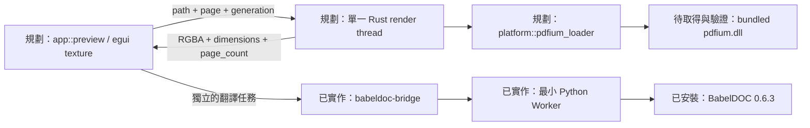

# Rust PDF 預覽設計

查核更新：2026-10-29，Asia/Taipei。**本文件是第 6 階段的待實作設計，不是 GUI／預覽已通過驗收。** 查核時 workspace 只有 `core`、`babeldoc-bridge`、`cli`（`Cargo.toml:2`）；沒有改動 Cargo、原始程式、runtime 或 dist，也沒有下載／安裝 native library。

## 建議與責任邊界

首版採 `eframe` 原生視窗加 `pdfium-render`，由 Rust 載入固定版本的 bundled PDFium DLL。每程序只初始化一組 PDFium bindings，所有文件／頁面／bitmap 操作集中於單一 Rust render thread；UI 只收 owned RGBA bytes、尺寸與頁數。預覽不呼叫 Python、PyMuPDF、BabelDOC Worker 或瀏覽器。

翻譯仍依賴 BabelDOC 的 Python 閉包；因此預覽改用 PDFium 不代表能刪除引擎的 PyMuPDF／Pillow。DLL 來源、雜湊、授權及 native closure 見 [NATIVE_DEPENDENCIES](NATIVE_DEPENDENCIES.md)。

| 方案 | 判斷 |
| --- | --- |
| Rust + PDFium DLL | 建議首版採用；直接取得像素，載入與生命週期邊界明確 |
| Rust 啟動 Poppler `pdftoppm.exe` | 技術可行；本機現有分發的靜態閉包為 33 個 PE 檔、約 54.7 MiB，另需資料／授權／subprocess 管理；保留作開發比對工具 |
| Python／PyMuPDF 產生圖再傳給 Rust | 不符合本次 Rust 預覽邊界 |

## 版本與 features

2026-10-29 重新查核，官方最新仍為 **eframe/egui 0.37.0**、**pdfium-render 0.9.4**。eframe 的 tagged manifest 要求 **Rust 1.95**；本機 Rust 1.99.1 滿足版本條件，但現有 workspace `rust-version = "1.88"` 不能代表 app 的最低需求。建議新 app crate 個別宣告 1.95，其他 crate 的最低版本另按實測維持。[egui release](https://github.com/emilk/egui/releases/tag/0.37.0)、[tagged workspace manifest](https://raw.githubusercontent.com/emilk/egui/0.37.0/Cargo.toml)、[pdfium-render 發行](https://docs.rs/crate/pdfium-render/latest)。

下列是**建議設定，尚未套用或解析新的 lockfile**：

```toml
[package]
rust-version = "1.95"

[dependencies]
eframe = { version = "=0.37.0", default-features = false, features = ["glow", "default_fonts", "system_fonts", "clipboard"] }
pdfium-render = { version = "=0.9.4", default-features = false, features = ["thread_safe", "pdfium_7881"] }

[target.'cfg(windows)'.dependencies]
windows-sys = { version = "=0.61.2", features = ["Win32_Foundation", "Win32_System_LibraryLoader"] }
```

使用 `eframe::egui` re-export。`system_fonts` 提供原生缺字補字，`clipboard` 支援系統貼上；設定持久化交給 core，不開 eframe `persistence`。accessibility／外部連結按完整 GUI 需求另選，不默默引入全部 default features。[eframe manifest](https://raw.githubusercontent.com/emilk/egui/0.37.0/crates/eframe/Cargo.toml)。

`pdfium-render` 的 `pdfium_latest` 實際指向 `pdfium_7881`，因此顯式固定該 API feature。關閉 wrapper 的 `image_latest`，用 `PdfBitmap::as_rgba_bytes()` 即可；不必為預覽轉換另開 image 的 JPEG 等功能。**整個 GUI 仍有 eframe icon 的 `image[PNG]` 相依**，不能宣稱完全沒有 image crate。[wrapper manifest](https://raw.githubusercontent.com/ajrcarey/pdfium-render/master/Cargo.toml)、[bitmap API](https://raw.githubusercontent.com/ajrcarey/pdfium-render/master/src/pdf/bitmap.rs)。

不開 `static`、`bindings`、`pdfium_future`、V8／XFA／Skia features。Windows x64 以 C ABI 動態載入，避免把 PDFium C++ 靜態庫、libclang 或 V8 build 帶進 Rust GNU 建置；這仍需實測，不是 ABI 相容性保證。

首版選 `glow`，減少 wgpu／shader compiler 的組包範圍。其官方程式明確要求 **OpenGL ≥2.0**，不支援 Windows OpenGL 1.1 軟體 context，故不能先宣稱 VM／RDP／基本顯示驅動均可用。[egui_glow 初始化](https://raw.githubusercontent.com/emilk/egui/0.37.0/crates/egui_glow/src/painter.rs)。

若目標機需要 Direct3D，再評估 `eframe/wgpu_no_default_features` 加同代 `wgpu 30.0` 的 `std`／`wgsl`／`dx12`；DXC 選項可能需額外 `dxcompiler.dll` 或 `static-dxc`，須另驗 GNU、native imports 與授權。此路徑尚未選定，不是現成免 DLL fallback。[egui-wgpu manifest](https://raw.githubusercontent.com/emilk/egui/0.37.0/crates/egui-wgpu/Cargo.toml)、[wgpu 30 manifest](https://raw.githubusercontent.com/gfx-rs/wgpu/v30.0.0/wgpu/Cargo.toml)。

## 有限範圍模組圖

下圖的 app／render／platform 模組全部是規劃；現有翻譯 bridge／Worker 不參與預覽。



renderer 放 app 的私有模組，core 不暴露 `PdfDocument`／`PdfPage`／GPU texture／Windows handles。平台 seam 僅負責 bundle 定位、庫名稱、受控載入與錯誤。未來 `cfg(target_os = "macos")` 可指向 `.app/Contents/Frameworks/libpdfium.dylib`；架構切片、簽章／notarization 另驗，目前不宣稱支援 macOS。

## 載入與執行緒契約

1. 從 `current_exe()` 定位 bundle，正規化 `native/pdfium/pdfium.dll` 絕對路徑，核對存在、AMD64 與 manifest；不以 CWD 定位。若提供開發 override，也只接受明確絕對路徑。
2. Windows GUI 程序啟動早期、其他載入工作之前，設定 `SetDefaultDllDirectories(LOAD_LIBRARY_SEARCH_SYSTEM32 | LOAD_LIBRARY_SEARCH_USER_DIRS)`，以 `AddDllDirectory` 加入唯一受信任的 PDFium native 目錄。檢查每個回傳值，保存 cookie 到預覽結束；不加入使用者 PDF 所在目錄。
3. render thread 呼叫 `Pdfium::bind_to_library(absolute_path)` 後 `Pdfium::new(bindings)`；禁止 `default()`、`bind_to_system_library()` 或失敗後改搜 PATH。缺檔／錯架構／缺 export／間接 DLL 失敗需有可讀的 native load 錯誤，預覽停用但不隱藏已產生的 PDF。
4. 每程序只初始化一次。0.9.4 使用全域 `OnceCell` 保存 bindings，drop `Pdfium` 不等於 DLL 可卸載／重新綁定；更新 DLL 必須重啟。[wrapper 載入與生命週期來源](https://raw.githubusercontent.com/ajrcarey/pdfium-render/master/src/pdfium.rs)。

絕對主 DLL 路徑不會自動限定其間接 DLL 的搜尋；Microsoft 指出 dependent DLL 仍可按名稱尋找。上述政策只影響本程序，不改全機 PATH／registry，也不會替 Python child 設好 loader。多個 user directories 的順序不保證，不能依加入順序處理同名 DLL 衝突。[DLL search order](https://learn.microsoft.com/en-us/windows/win32/dlls/dynamic-link-library-search-order)、[SetDefaultDllDirectories](https://learn.microsoft.com/en-us/windows/win32/api/libloaderapi/nf-libloaderapi-setdefaultdlldirectories)。

PDFium 不保證 thread safety；wrapper 的 `thread_safe` 用 mutex 序列化呼叫，不提供平行渲染加速。保留此 feature，同時限制所有 native handle 只在專用 thread。跨 thread 只送自有 bytes／基本 metadata；若需平行多文件，另評估不同 Rust render process。[作者的執行緒說明與 0.9.4 修正](https://raw.githubusercontent.com/ajrcarey/pdfium-render/master/README.md)。

## 頁面與像素契約

舊行為以 `pdf2zh_next/ui/preview.py:12` 的 `render_page()` 為準：頁碼 clamp、白底 RGB、一次一頁、倍率 ≤2、最長邊 ≤1600。Rust 預覽保留這些可見行為；不同 PDF renderer 的抗鋸齒差異另評估，不承諾逐像素相等。

請求包含 `{document_key, generation, path, page_one_based}`。key 必須包含輸出世代或檔案身分，不能只按路徑：同名 PDF 可能被新結果取代。renderer 開檔取得 page count 後再次 clamp；空文件、非 PDF、損壞、加密分別回可讀錯誤。

首版每次在 render thread 內 `load_pdf_from_file(&path, None)`，渲染後關閉文件，避免長期 Windows file lock 與 self-referential struct。API 使用 Rust `File`／reader；保留 `PathBuf`，不要把中文路徑轉有損 ANSI。需要文件快取時，再依量測在同一 thread 的局部作用域加入。[載入 API](https://raw.githubusercontent.com/ajrcarey/pdfium-render/master/src/pdfium.rs)。

1. 取得頁面尺寸，拒絕非有限或非正值；計算 `scale = min(2.0, 1600.0 / max(width, height, 1.0))`。
2. `PdfRenderConfig::new()` 配合 `scale_page_by_factor(scale)`、`set_maximum_width(1600)`、`set_maximum_height(1600)`、`set_format(PdfBitmapFormat::BGRA)`；明確白底及 annotations／form data 行為。不要套 `thumbnail()`，它會關閉註記／表單並減少平滑；`scale_page_to_display_size()` 會自動旋轉橫頁，也不適合直接取代基準。[render config](https://raw.githubusercontent.com/ajrcarey/pdfium-render/master/src/pdf/document/page/render_config.rs)。
3. `page.render_with_config()` 後用 `bitmap.as_rgba_bytes()` 複製像素。確認兩邊均為 `1..=1600`，checked multiplication 的 `width * height * 4` 等於 bytes 長度；白底結果以不透明 alpha 驗證，避免混淆 BGRA／RGBA／premultiplied 格式。
4. 在 render thread 先釋放 bitmap，再頁面，再文件／reader。只把 owned `Vec<u8>` 傳給 UI；不把 native buffer 裸指標傳出。
5. UI 用 `ColorImage::from_rgba_unmultiplied()` 建圖，再 `ui.ctx().load_texture(..., TextureOptions::LINEAR)` 或既有 `TextureHandle::set()`。constructor 對長度不符會 panic，必須先檢查。顯示保持比例，頁碼／載入中／錯誤獨立於圖片。[ColorImage](https://docs.rs/egui/latest/egui/struct.ColorImage.html)、[TextureHandle](https://docs.rs/egui/latest/egui/struct.TextureHandle.html)。

eframe 0.37 的必要入口為 `App::ui(&mut self, ui: &mut egui::Ui, frame: &mut Frame)`，不是舊版 `update(ctx, frame)`。`App::logic()` 可收取背景任務狀態但不能畫 UI；hidden window 亦可藉 `request_repaint()` 觸發 logic。耗時渲染不可放 UI／logic callback，完成後讓 render thread 喚醒 cloned context。[App trait](https://raw.githubusercontent.com/emilk/egui/0.37.0/crates/eframe/src/epi.rs)。

命令／結果通道有界，等待翻頁請求以最新 generation 取代；完成結果再核對 generation，舊頁直接丟棄。首版建議最多兩個可見 texture slot、單一 in-flight render，不建整份 PDF 圖片快取。1600² ×4 = **10,240,000 bytes** 只是單份像素上限；native bitmap、RGBA、ColorImage 與 GPU texture 可能同時存在，不能宣稱整個預覽只用 10 MB。換檔／關頁 drop 舊 handle；最後一份 `TextureHandle` drop 才釋放該 texture。

generation 取消只能跳過未開始工作／丟棄舊結果，不能立即中止同步 native render。正常退出停止送件、清空等待請求、等當頁完成後 join／釋放。若要求強制終止卡住的 native call，需獨立 Rust 預覽程序；不能強殺同程序 thread 或用 `catch_unwind` 冒充 native crash 隔離。

## 待實作驗收

| 項目 | 必要證據 |
| --- | --- |
| GNU GUI | 現有 rust-lld/self-contained 設定下的 app check／release build／視窗實際啟關；紀錄 GPU renderer／OpenGL 版本 |
| PDFium ABI | 固定 8125 DLL 的 archive／file SHA256、exports 綁定、實際四頁原文／mono／dual渲染；不預先保證 7881 bindings 相容 |
| 頁面品質 | 字型、公式、橫頁、固有 rotation、CropBox、透明圖、註記／表單；比對 renderer 差異並人工檢視 |
| 互動與限制 | 超界頁碼、中文／空格／長路徑、快速翻頁／換檔、最長邊 ≤1600、舊 generation 不覆蓋新結果 |
| 釋放 | 重複開關文件無持續累積、舊檔可移動／刪除、texture 數有界、退出無遺留工作 |
| 失敗行為 | 缺 DLL、錯 hash／架構、缺 export／間接 DLL、無合適 GPU；不隱性 fallback |
| 乾淨機 | 無 Python／Rust／開發工具的獨立 Windows；另驗無預裝 VC runtime。目前沒有 VM／Sandbox 通過證據 |

既有 [PDF 比對](POC_PDF_COMPARISON.json) 證明翻譯產出在 Poppler 下 8 頁像素差 0，沒有執行本設計的 Rust GUI 或 PDFium。翻譯測試結果見 [TEST_REPORT](TEST_REPORT.md)，不挪作預覽通過數字。

查核界線：2026-10-29 codebase-memory generation `2026-10-29T09:40:11Z` 的相關 repository paths 為 metadata 相符；`.cargo` excluded，已直接讀取。外部 crate 是作者來源／官方文件證據，尚未在本機編譯成 GUI。
