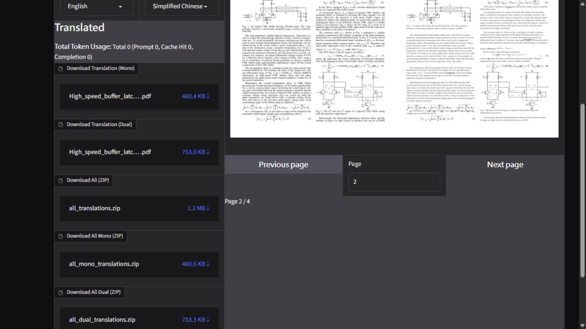

# 第三輪最終回歸

執行日期：2026-10-24；Windows、專案 Python 3.13.16；基準 1345fc2，功能修復最後提交 e0e0966。使用隔離設定與合成憑證，未呼叫付費 API。完整命令輸出位於忽略追蹤的 .test-output/round3/。

## 自動化與品質

| 項目 | 結果 | 證據／範圍 |
| --- | --- | --- |
| 完整 Pytest | **237 passed，0 failed，12.16 秒** | release-pytest.log／release-pytest.xml；標準執行沒有 warning summary |
| Retry / Backoff | **34 passed，3.40 秒** | final-retry.log；完整回歸亦包含這 34 項 |
| Ruff lint | 通過 | 使用現有 pyproject 規則，未降低選取／忽略設定 |
| Ruff format | **323 files already formatted** | 含文件程式區塊；不含被忽略的測試輸出 |
| uv pip check | 通過 | 專案環境與 134 套件發行環境 |
| MkDocs 一般 | 通過，136.77 秒 | final-docs-normal.log |
| MkDocs Strict | 通過，138.69 秒 | final-docs-strict-verified.log；未停用 link 或 Git metadata plugins |
| AST 防護 | 26 筆相同 | [07_final_retry_ast.json](07_final_retry_ast.json)：23 個 provider／IPC 檔案及 3 個 high_level 核心函式 |
| 靜態匯入分析 | 55 模組、126 邊、無 SCC 循環 | [07_import_graph.json](07_import_graph.json)；不涵蓋動態載入 |
| Git diff --check | 通過 | 最終提交前再次檢查 |
| 依賴安全稽核 | **未通過，exit 1** | 47 項去重公告，見下文 |

基準重跑為 211 passed、1 failed、67 warnings（12.25 秒），並非直接接受上一輪 212 passed。重現的 Windows atomic replace WinError 5 已用故障注入測試修復。測試新增 25 項；未刪除或放寬既有測試。時間受快取／主機負載影響，不視為效能提升的基準實驗。

額外 warnings-as-errors 診斷在第四階段為 223 passed、1 failed：Gradio 建構元件後 Windows Proactor loop／socket 未關閉，GC 觸發 PytestUnraisableExceptionWarning。此項沒有宣稱通過，亦未全面 suppress。一般回歸通過不代表已修復這個第三方資源生命週期問題。

## CLI、GUI、EXE

CLI 小型真實 PDF 與無效輸入組合：成功／部分失敗／全失敗 exit 0／1／1，輸出 PDF 2／2／0；合成 Key 不在日誌。最終 EXE 從其他 cwd：version exit 0、未知參數 exit 2、失敗路徑（無效 PDF／不可用 loopback API）exit 1。config/default/2.9.0.toml 位於 EXE 旁，其他 cwd 沒有建立 config。

Python GUI 與 EXE GUI 均在真實 in-app browser 開啟，未出現空白頁；上傳指定四頁文件、Page 1→2、清除、服務設定、儲存、翻譯結果預覽均實際操作。Python 階段實際下載 mono／dual／ZIP；EXE 階段實際下載 mono 到 Downloads（新增 (1) 檔，保留未刪除）。Console error 為 0；Gradio 泛用 Method not implemented warning 不作為 error 隱藏。

另以 gradio_client 對最終來源與最終交付 EXE 驗證上傳、191 個設定回載、19 個翻譯輸出、mono／dual PDF 與含 2 項的 ZIP 下載；單頁 fixture 各 3 次本機 API 請求、1 批次。這些 HTTP/API 檢查是瀏覽器證據的補充。完整多頁瀏覽器證據在最後公開 API 單行匯入修復之前取得；最終交付包又重跑首頁／API 流程，UI 與任務模組內容逐檔相同。

最終 Python GUI 17866 與 EXE GUI 17869 均只監聽 127.0.0.1，見 [07_network_bindings.txt](07_network_bindings.txt)。沒有用另一台實體裝置做連線測試；作業系統 socket 證據證明沒有預設綁定 LAN／所有介面。明確指定非 loopback／share 的分支以測試驗證警告與參數傳遞，未為驗證而實際公開伺服器。完成後停止本輪伺服器並關閉自建分頁。

瀏覽器自動化 file chooser／download 呼叫有數分鐘等待，這不作為應用處理速度的效能數據；HTTP/client 流程與截圖另行確認完成結果。

## 指定 PDF 與排版

輸入：High_speed_buffer_latch_ISCAS03.pdf，四頁。基準、最終 Python CLI 與最後交付 EXE 均只送本機 OpenAI identity server：107 次請求、36 批次；各產生四頁 mono 與四頁 dual。未用不同真實翻譯回應比較逐位元組 PDF。

[07_pdf_comparison.json](07_pdf_comparison.json) 逐頁記錄 Poppler -layout 文字 SHA、字數、公式符號數（代理指標，非公式語意證明）、嵌入圖片數；結構均相同。以相同 Poppler、96 DPI 渲染 mono／dual 各四頁，Python 與 EXE 對基準共 16 組比較均 changed_pixel_fraction=0、mean_channel_difference=0。PDF 二進位 SHA／檔案大小可因 metadata／ID 不同而不同，沒有要求位元組一致。

視覺檢查第二頁公式 (4) 附近仍有文字與公式重疊、局部斷字；電路圖片保留。這些缺陷在基準與最終的像素相同。Identity 回傳原文會觸發 BabelDOC「same as input」及 simple translation fallback，不能代表真正中文翻譯品質。BabelDOC 0.6.3／PyMuPDF 1.26.7 與字型排版核心未改動；目前證據支持「既有上游排版／fallback 路徑問題」，未充分區分每個字型／公式缺陷的單一根因，不直接修改第三方核心。

table_model retired 的原始原因另有源碼確認：上游無條件忽略傳入模型。本輪停止建構不會使用的 RapidOCR，保留舊選項與明確不可用訊息。

## 套件與可重現組包

最後 wheel 在 .test-output/round3/release-wheel/；EXE 在 .test-output/round3/exe-release/。官方既有 PyStand 1.1.4 與 embedded Python 3.13.3，配合 locked no-dev、no-editable 安裝；發行套件由 Python 3.13.16 建置（相同 3.13 ABI）。[07_package_integrity.json](07_package_integrity.json) 記錄 59 個套件檔案與 wheel 一致、無 editable .pth、所需 CSS／YAML／logo／新模組均存在、BUILD_INFO lock SHA 正確。

本機使用 -SkipOfflineAssets，沒有重新產生龐大離線資產 ZIP。首次運作需要既有快取或下載官方模型／字型；測試使用隔離 profile 的快取。不能把本機組包成功視為乾淨離線機已驗證。Docker 未安裝，未實際建置映像；GitHub Actions 雲端 release job 未執行。

## 安全掃描

完整原始最終輸出：[07_final_audit.json](07_final_audit.json)。uv 0.13.1 audit 為 experimental，--locked --no-dev 以及加 --python-version 3.13 --python-platform windows 仍回報跨版本鎖檔的 filelock 4.1.0，未把工具旗標當作已排除該分支的證明。

基準 68 項去重公告；候選階段 39；最終資料庫更新後 47：Pillow 12.3.0 為 41，Python <3.11 分支 filelock 4.1.0 為 6。pre-commit 間接依賴 virtualenv 21.14.12 的新公告已以 21.14.13 修復。最終 EXE 實際 filelock 4.2.4、Pillow 12.3.0；依安裝版本篩選最終掃描為 Pillow 41 項，這是適用性計算，沒有宣稱獨立稽核通過。

Pillow 公告多要求 13.0.0，而 Gradio 6.30 限制 <13；filelock 修補線要求 Python >=3.11，保留 Python 3.10 相容性時仍有舊分支風險。沒有強制忽略／override 依賴限制。緩解為預設 loopback、僅處理可信 PDF／圖片、避免無驗證公開服務、快取目錄僅本人可寫；這些措施不能視為漏洞已修補。詳見 [07_audit_summary.json](07_audit_summary.json)。

## 尚未覆蓋

沒有呼叫付費／真實 provider API、沒有外部裝置／公開隧道測試，沒有惡意 PDF 全面滲透測試；實際中文品質、長時間／高併發／硬終止資源壓力、跨平台與全部 Python 3.10–3.12 runtime 未實機驗證。Timeout／429／5xx／jitter／取消／IPC 的既有 characterization、GUI 成功／錯誤／取消測試與 AST 防護通過；不等同於所有真實 provider 行為或長期資源釋放已證明。
